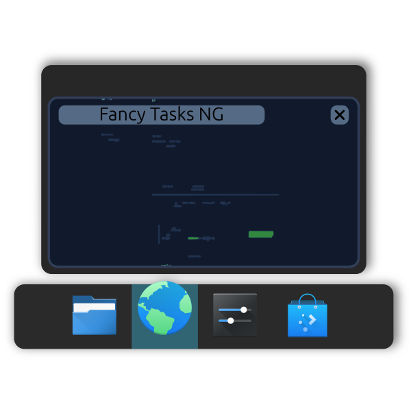

<h1 align="center">Taskline</h1>
<p align="center">
  
</p>
<p align="center">
  <strong>A feature-rich task manager for KDE Plasma 6, forked from Fancy Tasks NG.</strong>
</p>
<p align="center">
  <a href="https://github.com/divinae/Taskline/releases/latest">
    
  </a>
  
  
  
</p>

---


---

## What is this?

**Taskline** is an alternative task manager for KDE Plasma 6, a fork of [Fancy Tasks NG](https://github.com/daydve/FancyTasksNG) by Vitaliy Elin. It uses its own name and widget ID (`io.github.divinae.taskline`), so it can be installed next to Fancy Tasks NG without conflicts.

On top of Fancy Tasks NG it adds, among others: native Plasma tooltips with larger, smoothly scaled and rounded thumbnails sized to each window, titles that highlight what differs between windows, media controls shown on the window that actually plays (including browser web apps such as a Spotify app), unread-notification badges, Windows-style attention signals (a short bounce, then a steady mark, plus a bouncing icon at the screen edge for auto-hidden panels), Force Quit, Open at Login, window counts and a configurable tooltip delay. See the [CHANGELOG](CHANGELOG.md).

Fancy Tasks NG itself builds upon the native task manager concepts by offering deeper customization and additional visual features like animated activity indicators, smart notification badges on app icons, volume scroll controls, dynamic hover zoom, centered alignment, and rich tooltips.

## History of Fancy Tasks NG (by its author, Vitaliy Elin)

I used the original [FancyTasks](https://github.com/alexankitty/FancyTasks) by [alexankitty](https://github.com/alexankitty) for many years. When Plasma 6 came out, I thought the project was dead. Later, I found a fork ([FancyTasksPlus](https://github.com/SushiTrashXD/FancyTasksPlus) by [SushiTrashXD](https://github.com/SushiTrashXD)) that attempted to port it to Plasma 6. 

Unfortunately, as Plasma continued to evolve (especially after 6.4), the code started breaking and the widget stopped working entirely. I temporarily went back to the standard Plasma task manager, but I really missed the features I was used to. 

So, I decided to fork the project for myself just to restore basic compatibility with modern Plasma. After getting it to work, I started making a few small tweaks here and there. What started as a simple compatibility fix quickly grew into a major overhaul. I ended up completely rewriting large chunks of the codebase, removing legacy code, and adding a bunch of new features I had always wanted. Thus, **Fancy Tasks NG** (Next Generation) was born.

## Overview of Capabilities

Taskline is a standalone task manager widget that includes the following features:
- **Alignment:** Built-in option to align tasks to the center of the panel.
- **Background Data Integration:** A custom D-Bus bridge enables the display of unread message badges and task progress bars directly on pinned icons, even if the application has no active windows.
- **Interaction Shortcuts:** Support for adjusting the volume of individual applications via mouse wheel scroll over their icons.
- **Configuration Preview:** A Live Preview component in the settings window displays changes in real time before they are applied.
- **Visual Effects:** Configurable options for icon hover zoom animations, custom indicator styles, and particle effects when closing windows.

For a complete list of features and version history, refer to the [CHANGELOG](CHANGELOG.md).

## Requirements

- **KDE Plasma 6.5** (or newer)
- **python3** with the **dbus-python** and **PyGObject** modules, for jump lists, recent documents, browser history, notification badges and configuration export/import (packages: `python-dbus` and `python-gobject` on Arch, `python3-dbus` and `python3-gi` on Debian/Ubuntu, `python3-dbus` and `python3-gobject` on Fedora)

## How to install

### From source (Highly Recommended)
This is the best way to ensure you have the absolute latest version:

```bash
# 1. Grab the code
git clone https://github.com/divinae/Taskline.git
cd Taskline

# 2. Build and install (this handles everything for you)
make install
```
Once it's done, right-click your panel, select **Add Widgets**, and look for **"Taskline"**.

### From a pre-built package
If you prefer not to use `make`, you can download the latest `Taskline.plasmoid` file from the [Releases page](https://github.com/divinae/Taskline/releases) and install it from the terminal:

```bash
kpackagetool6 -t Plasma/Applet --install Taskline.plasmoid
```

### Testing an in-development build
Want to try a fix or feature before it's released? Every commit to `develop` that touches the widget gets built automatically and uploaded as a workflow artifact — no need to build it yourself. Grab it from the **[Nightly Build workflow runs](https://github.com/divinae/Taskline/actions/workflows/nightly.yml)**: open the latest successful run and download the `.plasmoid` from its Artifacts section (requires being signed in to GitHub), then install it the same way as above.

*(These are unreleased, in-progress builds — expect rough edges. The version shown in the widget's settings tells you exactly which commit it was built from.)*

### From the KDE Store
You can also grab it from the [KDE Store](https://store.kde.org/p/2350434) straight through the Plasma "Get New Widgets" dialog.
*(Note: The KDE Store version might occasionally be a bit behind the GitHub releases.)*

## Keeping it updated

If you installed from source, updating is a breeze. Just open a terminal in your cloned `Taskline` folder and run:

```bash
git pull
make update
```
This will fetch the latest code, recompile what's needed, install the update, and seamlessly restart Plasma for you. 

## Uninstallation

If you ever need to remove it, make sure you first delete any Taskline widgets from your panels. Then run:

```bash
make uninstall
```

## Contributing
Found a bug? Have a great idea for a feature? All contributions are welcome! 

Head over to the [GitHub Issues tracker](https://github.com/divinae/Taskline/issues) to report bugs or request features.

## Acknowledgements

This project wouldn't exist without the amazing work of the original authors and the KDE community. A massive thank you to:

| Who | What they did |
|---|---|
| [Vitaliy Elin](https://github.com/daydve) | Created Fancy Tasks NG, the Plasma 6 rewrite this project is forked from. |
| [SushiTrashXD](https://github.com/SushiTrashXD) | Created FancyTasksPlus (the initial Plasma 6 port that Fancy Tasks NG started from). |
| [Alexandra Stone](https://github.com/alexankitty) | Created the original FancyTasks for Plasma 5, pioneering the animated indicators and badges. |
| [Luis Bocanegra](https://github.com/luisbocanegra) | Implemented the original hover-zoom logic. |
| The Community | Everyone who has submitted bug reports, PRs, and ideas. |

---

<p align="center">
  <sub>Licensed under GPL-3.0-or-later &nbsp;·&nbsp; Maintained by <a href="https://github.com/divinae">Jakub Lipinski</a> · Based on Fancy Tasks NG by <a href="https://github.com/daydve">Vitaliy Elin</a></sub>
</p>
